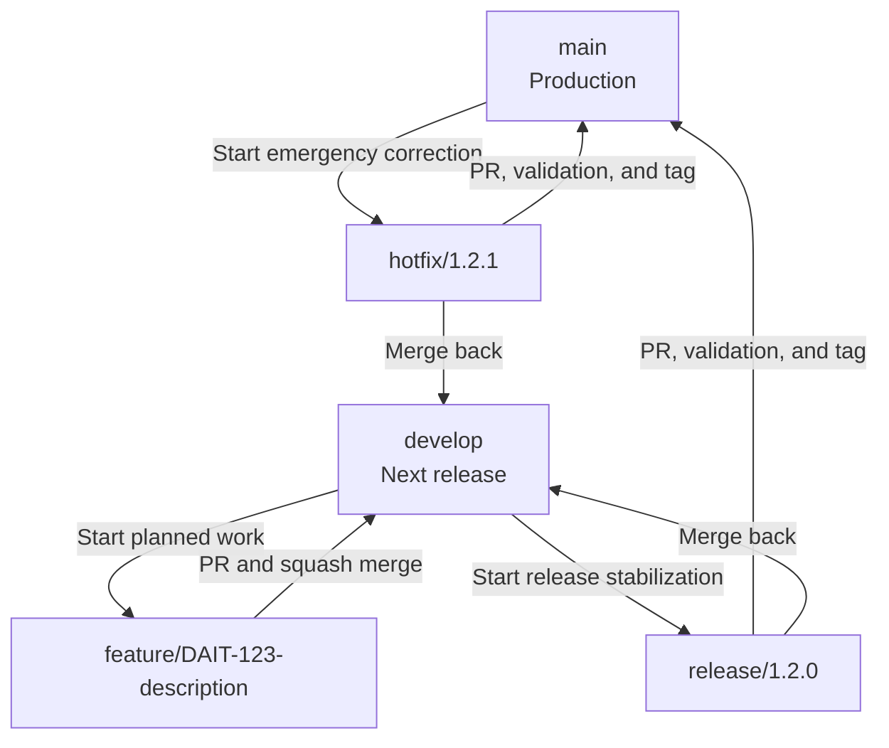

# DAIT GitFlow and Versioning Standard

| Document field | Value |
|---|---|
| Owner | DAIT Platform Engineering |
| Standard version | 1.0 |
| Applies to | All DAIT-managed software, infrastructure, firmware, and documentation repositories |
| Default branch | `main` |
| Integration branch | `develop` |
| Versioning model | Semantic Versioning 2.0.0 |
| Commit format | Conventional Commits |

## 1. Purpose

This document defines the mandatory source-control, branching, review, release, and versioning rules for DAIT Technologies repositories. Its goals are to make every change traceable, keep production branches stable, support parallel product development, and produce reproducible releases across the DAIT software stack.

The keywords **MUST**, **MUST NOT**, **SHOULD**, and **MAY** express the strength of each rule.

## 2. Core Rules

1. `main` MUST contain only production-ready code.
2. `develop` MUST contain the integrated state of the next planned release.
3. Direct pushes to `main` and `develop` MUST be prohibited.
4. Every change MUST be linked to a tracked issue, requirement, incident, or approved engineering task.
5. Every merge into `main` or `develop` MUST pass review and the required automated checks.
6. Production releases MUST be represented by immutable, annotated Git tags.
7. Secrets, private keys, credentials, tokens, customer data, and production configuration MUST NOT be committed.
8. Release and hotfix changes MUST be synchronized back into `develop`.

## 3. Branch Model



### 3.1 Long-lived branches

| Branch | Role | Deployment meaning |
|---|---|---|
| `main` | Authoritative production history | A commit on `main` is releasable; a tagged commit is an official release |
| `develop` | Integration branch for the next release | Deployable to integration or development environments after CI succeeds |

### 3.2 Short-lived branches

| Pattern | Created from | Merged into | Example |
|---|---|---|---|
| `feature/<issue>-<description>` | `develop` | `develop` | `feature/DAIT-123-energy-aware-scheduling` |
| `release/<version>` | `develop` | `main` and `develop` | `release/1.4.0` |
| `hotfix/<version>` | `main` | `main` and `develop` | `hotfix/1.4.1` |

Branch descriptions MUST use lowercase kebab-case after the issue identifier. Spaces, personal names, and generic names such as `test`, `new`, or `changes` MUST NOT be used.

## 4. Feature Branch Procedure

Feature branches are used for planned development, refactoring, non-emergency defect correction, documentation, and test improvements.

### Start

```bash
git checkout develop
git pull --ff-only origin develop
git checkout -b feature/DAIT-123-energy-aware-scheduling
```

### Rules

- A feature branch MUST start from the current `develop` branch.
- The branch SHOULD address one coherent requirement or issue.
- The branch MUST remain short-lived and SHOULD be synchronized with `develop` when necessary.
- Tests and documentation MUST be updated with the implementation.
- A pull request MUST target `develop`.
- The pull request MUST use **Squash and merge** after approval and successful checks.
- The resulting squash commit MUST use a Conventional Commit title.
- The branch MUST be deleted after the merge.

## 5. Release Branch Procedure

A release branch freezes the planned feature set and provides a controlled location for validation, documentation, packaging, and version preparation.

### Start

```bash
git checkout develop
git pull --ff-only origin develop
git checkout -b release/1.4.0
```

### Permitted changes

- Version metadata updates
- Release notes and `CHANGELOG.md`
- Documentation corrections
- Packaging and deployment adjustments
- Defect fixes required for the release
- Security fixes identified during release validation

New product features MUST NOT be added to an active release branch.

### Complete

1. Open a pull request from `release/1.4.0` to `main`.
2. Complete all required tests, security scans, reviews, and release approvals.
3. Merge using **Create a merge commit**.
4. Create the annotated release tag on the resulting `main` commit:

   ```bash
   git checkout main
   git pull --ff-only origin main
   git tag -s v1.4.0 -m "DAIT component release v1.4.0"
   git push origin v1.4.0
   ```

5. Merge the release branch back into `develop` using a pull request and **Create a merge commit**.
6. Confirm that `main` and `develop` contain all release fixes.
7. Delete the release branch only after both merges are complete.

If signed tags are not yet operational, an annotated tag MAY be used temporarily, but signed tags remain the target control.

## 6. Hotfix Branch Procedure

A hotfix branch is reserved for an urgent production defect, security vulnerability, data-integrity risk, or operational failure that cannot wait for the next planned release.

### Start

```bash
git checkout main
git pull --ff-only origin main
git checkout -b hotfix/1.4.1
```

### Complete

1. Implement the smallest safe correction.
2. Add or update the test that reproduces the failure.
3. Document impact, risk, validation evidence, and rollback instructions in the pull request.
4. Open a pull request from `hotfix/1.4.1` to `main`.
5. Obtain approval and pass the required CI and security checks.
6. Merge using **Create a merge commit**.
7. Tag the resulting `main` commit as `v1.4.1`.
8. Merge the hotfix back into `develop`.
9. If a release branch is open, merge the hotfix into that release branch as well.
10. Delete the hotfix branch only after every required synchronization is complete.

Emergency status does not remove review, testing, traceability, or tagging requirements. A formally documented break-glass process is the only exception.

## 7. Semantic Versioning

DAIT uses the following version format:

```text
MAJOR.MINOR.PATCH
```

| Increment | Use when | Example |
|---|---|---|
| `MAJOR` | The release introduces an incompatible API, configuration, protocol, data-model, deployment, or operational change | `1.8.4` → `2.0.0` |
| `MINOR` | The release adds backward-compatible functionality | `1.8.4` → `1.9.0` |
| `PATCH` | The release contains backward-compatible fixes or security corrections | `1.8.4` → `1.8.5` |

Pre-release versions use identifiers such as:

```text
1.5.0-alpha.1
1.5.0-beta.1
1.5.0-rc.1
```

Git tags MUST include the `v` prefix:

```text
v1.5.0
v1.5.1
v2.0.0-rc.1
```

### 7.1 Version authority

- The immutable Git tag is the authoritative identity of a released source state.
- Package, chart, binary, firmware, and container versions MUST match the Git release version.
- Production deployments MUST reference immutable versions or digests and MUST NOT depend on `latest`.
- A release tag MUST never be moved, overwritten, or reused.

### 7.2 Multi-repository platform releases

Each independently deployable DAIT component SHOULD use its own Semantic Version. A DAIT platform release MUST publish a release manifest or software bill of materials that pins each component to an immutable version and, where applicable, a container digest.

Example:

```yaml
platformVersion: 1.0.0
components:
  command-control-manager: 1.2.0
  security-manager: 1.1.3
  energy-aware-scheduler: 0.9.0
  edge-agent: 1.0.1
```

This allows the DAIT platform to have a controlled product release without forcing every component to share the same development cadence.

## 8. Conventional Commits

Commit messages and squash-merge pull request titles MUST follow this format:

```text
<type>(<scope>): <description>
```

Examples:

```text
feat(scheduler): add thermal-aware GPU placement policy
fix(ipmi): handle unavailable inlet temperature sensor
perf(telemetry): reduce high-cardinality metric processing
docs(api): document workload forecast endpoint
ci(security): add container vulnerability scan
refactor(control-plane): isolate device command dispatcher
feat(api)!: replace legacy workload submission schema
```

| Type | Meaning | Typical version impact |
|---|---|---|
| `feat` | New backward-compatible capability | MINOR |
| `fix` | Defect or security correction | PATCH |
| `perf` | Backward-compatible performance improvement | PATCH |
| `refactor` | Internal code change without intended behavior change | Usually PATCH or none |
| `docs` | Documentation only | None |
| `test` | Test-only change | None |
| `build` | Build system or dependency change | Context dependent |
| `ci` | CI/CD configuration change | None |
| `chore` | Maintenance work | None |

A breaking change MUST be marked with `!` or a `BREAKING CHANGE:` footer and normally requires a MAJOR version increment.

## 9. Pull Request Requirements

Every pull request MUST include:

- A concise summary and business or technical purpose
- A linked issue, incident, requirement, or change record
- The change type and affected components
- Test evidence
- Security impact assessment
- Configuration, database, API, infrastructure, and compatibility impact
- Deployment and rollback notes when operational behavior changes
- Documentation updates where required

The author MUST NOT approve their own pull request. At least one authorized reviewer MUST approve the change. Security-critical, architecture-critical, and production-release changes SHOULD require approval from the responsible code owner.

## 10. Required Automated Gates

The checks enabled for a repository depend on its technology, but the standard pipeline SHOULD include:

1. Formatting and linting
2. Unit tests
3. Build or package validation
4. Dependency and software-composition analysis
5. Secret scanning
6. Static application security testing
7. Container-image scanning where containers are produced
8. Infrastructure-as-code scanning where applicable
9. Integration or contract tests where applicable
10. Artifact provenance, checksum, and signing controls for releases

Required checks MUST have unique and stable names so that GitHub branch rules can enforce them reliably.

## 11. GitHub Repository Configuration

### Merge settings

| Setting | DAIT standard | Reason |
|---|---|---|
| Allow merge commits | Enabled | Required for release and hotfix synchronization |
| Allow squash merging | Enabled | Used for feature pull requests |
| Allow rebase merging | Disabled | Avoids inconsistent integration history |
| Automatically delete head branches | Disabled | Release and hotfix branches must merge into more than one target before deletion |
| Require linear history | Disabled | Classic GitFlow requires controlled merge commits |

### Protection for `main`

- Require a pull request before merging
- Require at least one approval
- Require code-owner approval where ownership is defined
- Dismiss stale approvals when new commits are pushed
- Require approval of the most recent reviewable push
- Require required status checks to pass
- Require all conversations to be resolved
- Block force pushes
- Block deletion
- Apply rules to administrators where the selected GitHub plan supports it

### Protection for `develop`

- Require a pull request before merging
- Require at least one approval
- Require required status checks to pass
- Require all conversations to be resolved
- Block force pushes
- Block deletion

### Protection for `release/*` and `hotfix/*`

- Restrict creation and updates to authorized maintainers or release managers where supported
- Require pull requests for merges into protected long-lived branches
- Block force pushes
- Preserve the branch until all mandatory merge-back operations are complete

## 12. Release Checklist

Before creating an official release tag, the release owner MUST verify:

- [ ] Release scope is approved and frozen
- [ ] Version number follows Semantic Versioning
- [ ] Required CI checks are successful
- [ ] Security findings are resolved or formally accepted
- [ ] Database and configuration changes are documented
- [ ] Upgrade and rollback procedures are documented
- [ ] `CHANGELOG.md` and release notes are complete
- [ ] Artifacts are reproducible and tied to the release commit
- [ ] Release tag is annotated and preferably signed
- [ ] Release or hotfix changes are merged back into `develop`
- [ ] Component versions are pinned in the platform release manifest

## 13. Prohibited Practices

- Direct routine development on `main` or `develop`
- Force-pushing or rewriting protected branch history
- Reusing or moving a release tag
- Committing secrets or production data
- Merging a feature directly into `main`
- Adding new features to a release branch after scope freeze
- Closing a release or hotfix without merging its changes back into `develop`
- Deploying an unversioned or mutable `latest` artifact to production
- Bypassing failed CI or security checks without documented authorization

## 14. Exceptions

Any deviation from this standard MUST be documented in an Architecture Decision Record or emergency change record. The record MUST state the reason, risk, approving authority, duration, compensating controls, and plan to return to the standard process.

## 15. Quick Reference

```text
Planned work:       develop -> feature/* -> develop
Planned release:    develop -> release/x.y.z -> main -> tag vX.Y.Z
Release sync:       release/x.y.z -> develop
Production fix:     main -> hotfix/x.y.z -> main -> tag vX.Y.Z
Hotfix sync:        hotfix/x.y.z -> develop and any active release branch
Feature merge:      Squash and merge
Release merge:      Create a merge commit
Hotfix merge:       Create a merge commit
Production source:  main
Next-release source: develop
```

