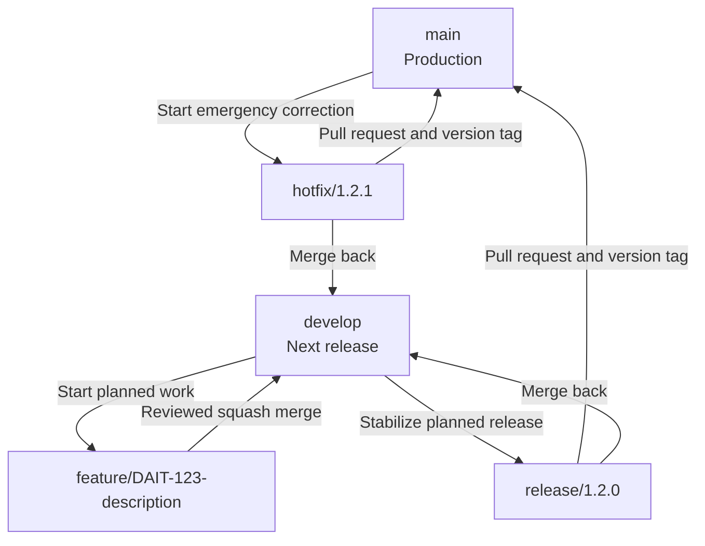

# DAIT Technologies

DAIT Technologies develops secure infrastructure and operations management solutions for AI, HPC, and distributed edge data-center environments. Our engineering approach combines hardware-aware orchestration, energy and thermal intelligence, secure remote operations, predictive maintenance, and auditable software delivery.

## Engineering Principles

- **Secure by design** — identity, access, encryption, and auditability are built into the platform lifecycle.
- **Infrastructure-aware intelligence** — compute, GPU, power, cooling, and environmental telemetry are treated as one operational system.
- **Reproducible delivery** — every production release is reviewed, tested, versioned, tagged, and traceable.
- **Open standards first** — DAIT integrates proven technologies and adds purpose-built orchestration, security, and optimization capabilities.

## DAIT GitFlow Standard

All DAIT software repositories follow a common GitFlow policy. The `main` branch represents production-ready code, while `develop` contains the integrated state of the next planned release.



| Branch type | Source | Destination | Purpose |
|---|---|---|---|
| `feature/*` | `develop` | `develop` | Planned product development |
| `release/*` | `develop` | `main` and `develop` | Release stabilization and version preparation |
| `hotfix/*` | `main` | `main` and `develop` | Urgent production correction |

DAIT releases use [Semantic Versioning](https://semver.org/) and immutable Git tags:

```text
vMAJOR.MINOR.PATCH
v1.0.0
v1.4.0
v1.4.1
```

- **MAJOR** — incompatible API, configuration, data-model, or operational changes.
- **MINOR** — backward-compatible capabilities.
- **PATCH** — backward-compatible fixes, including security and stability corrections.

For the complete branch, merge, commit, release, and versioning policy, see the [DAIT GitFlow Standard](https://github.com/DAIT-Technologies/.github/blob/main/GITFLOW.md).

---

**DAIT Technologies — Secure, Intelligent, and Energy-Aware Infrastructure Operations**
